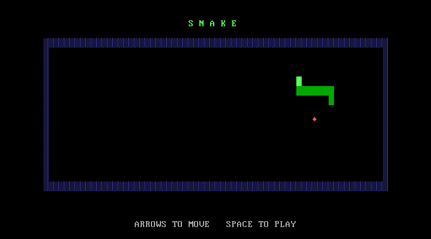
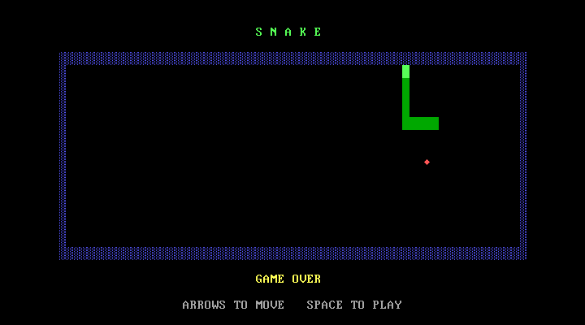

# Snake in 512 bytes

Snake for a legacy x86 PC BIOS, written entirely in 16-bit assembly. The BIOS boots the game directly from a single 512-byte sector.



## Play

With QEMU installed, run the included [floppy image](snake.img) from the repository directory.

```sh
qemu-system-x86_64 -drive file=snake.img,format=raw,if=floppy,readonly=on -boot a
```

- Press **Space** to start. The snake begins moving right.
- Use the **arrow keys** to steer. A direct reversal is ignored.
- Eat the red diamonds to grow. Fill all 868 cells to win.
- Hitting a wall or your own body ends the game. Press **Space** to play again.

## Build from source

On macOS or Linux, use Clang, Make, `objdump` (GNU or LLVM), and `xxd`. If LLVM's tool is named `llvm-objdump` on your system, run `make -B OBJDUMP=llvm-objdump`.

```sh
make -B
wc -c < snake.img
```

The count is **512**. The assembler reserves the final two bytes for the BIOS boot signature, `55 aa`, and fails if the game exceeds the space before it.

## How it fits

[The assembly source](snake.s) uses VGA text memory for both drawing and collision checks. A circular buffer in RAM stores the screen offset of each segment. On a normal move, the tail cell is cleared. When the head eats food, the tail stays in place and the game spawns new food if an empty cell remains. BIOS keyboard input handles the arrow keys, and the BIOS timer advances the snake roughly nine cells per second.

| Boot sector contents | Bytes |
| --- | ---: |
| Code and display strings | 506 |
| Padding | 4 |
| Boot signature | 2 |
| **Total** | **512** |

## After a collision


